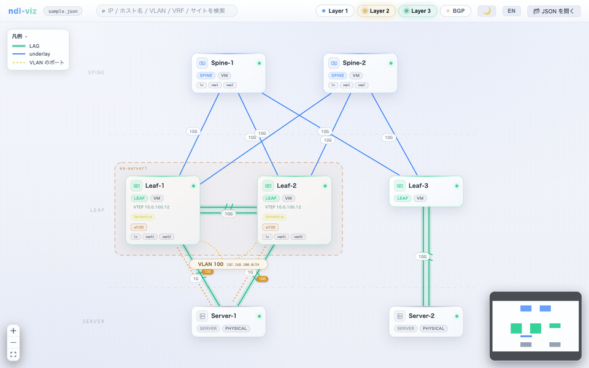
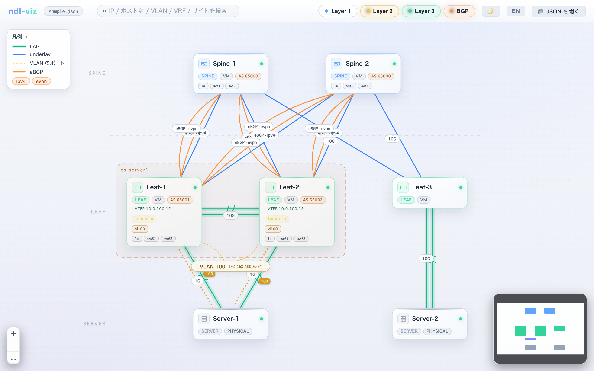
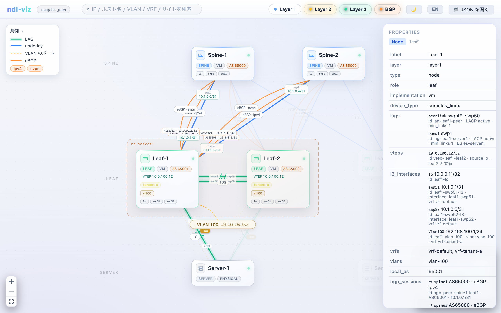

# ndl-viz

[](https://github.com/yone2ks/ndl-viz/actions/workflows/ci.yml)

[mlndl](https://github.com/yone2ks/mlndl) が出力する Cytoscape.js JSON を読み込み、ネットワークのトポロジーを描くビューワです。
物理のリンク (L1) をいつも描き、Layer 2 (VLAN・VXLAN)・Layer 3 (IF・VRF・OSPF / IS-IS)・BGP をボタンで重ねます。
開いたときは Layer 2・3 を重ねた状態で、BGP はボタンで足します。

表示するのは MLNDL に書かれた情報だけです。書かれていないこと (ノードの代表アドレス、セッションの underlay / overlay など) は推定して埋めません。

**デモ**: https://yone2ks.github.io/ndl-viz/?data=sample.json



## デモ

ブラウザで開くだけで、見本のトポロジーを触れます。

| 見本 | 内容 |
|---|---|
| [sample.json](https://yone2ks.github.io/ndl-viz/?data=sample.json) | Spine-Leaf・EVPN / VXLAN・MLAG (Ethernet Segment)・eBGP。サーバー 2 台が leaf をまたいで同じ VLAN に |
| [multisite.json](https://yone2ks.github.io/ndl-viz/?data=multisite.json) | データセンター (EVPN / VXLAN・MLAG・border leaf) とキャンパスを WAN の eBGP でつないだ 2 サイト。テナントの VRF は VRF-lite で渡す |
| [wan-sites.json](https://yone2ks.github.io/ndl-viz/?data=wan-sites.json) | 4 拠点とクラウドを、専用線・事業者網 (IP-VPN・広域イーサ・インターネット・閉域接続) でつないだ WAN |
| [eveng-evpn.json](https://yone2ks.github.io/ndl-viz/?data=eveng-evpn.json) | EVE-NG で組んだ EVPN の学習ラボ |
| [fabrics-superspine.json](https://yone2ks.github.io/ndl-viz/?data=fabrics-superspine.json) | 3 つのファブリックを Super-Spine で束ねた 5 段の Clos (L1 だけ) |

手元の JSON は、デモの画面にドロップしても開けます。ファイルはブラウザの中で読むだけで、どこにも送りません。

## 使い方

```bash
npm install
```

```bash
npm run dev
```

http://localhost:5173 を開き、JSON をドロップするか、右上の「JSON を開く」から読み込みます。
`public/` に置いた JSON は `?data=wan-sites.json` のように URL で指定して開けます。

JSON は mlndl で YAML から作ります。

```bash
python -m mlndl export --format cytoscape topology.yaml > public/topology.json
```

## 画面



- サイト (`labels.site`) ごとに枠を描き、事業者網 (`role: provider-network`) は拠点の上に雲で描きます
- BGP / OSPF / IS-IS はセッション 1 本を 1 本の線で描きます。通り道が事業者網の bridge やトンネルなら、線の札に「… 経由」を添えます
- 機器・リンク・セッションを選ぶと、右のパネルに MLNDL の値が出ます
- IP・ホスト名・VLAN・VRF・サイトで検索できます。表示は日本語と英語を切り替えられます



## 開発

```bash
npm run build
```

```bash
npm run lint
```

`main` に入ると、GitHub Actions (`.github/workflows/pages.yml`) がビルドしたものをデモ (GitHub Pages) に出します。

## ライセンス

MIT License (`LICENSE`)
